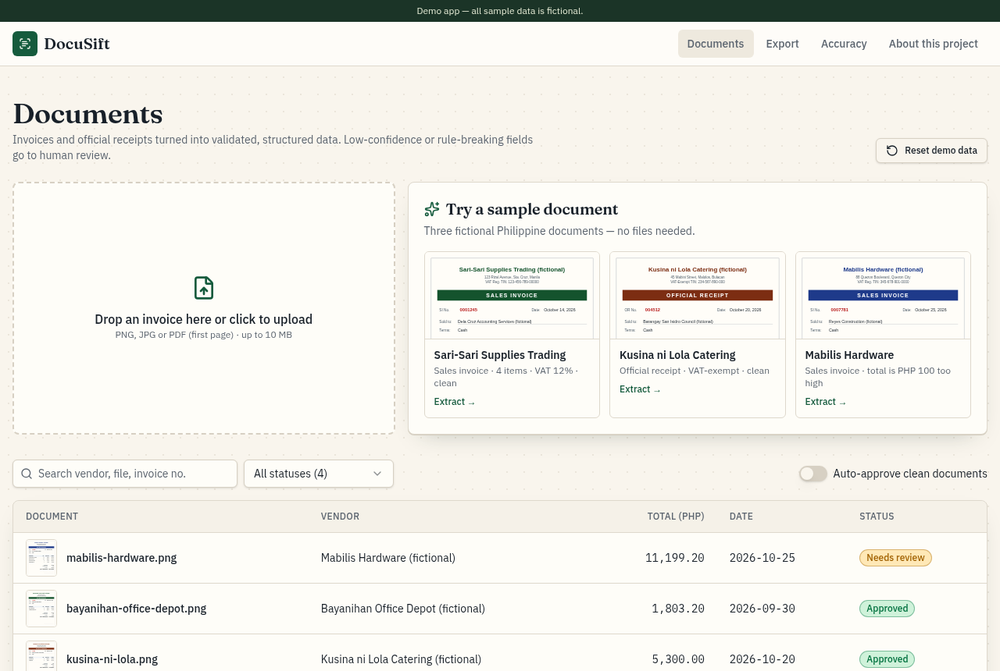
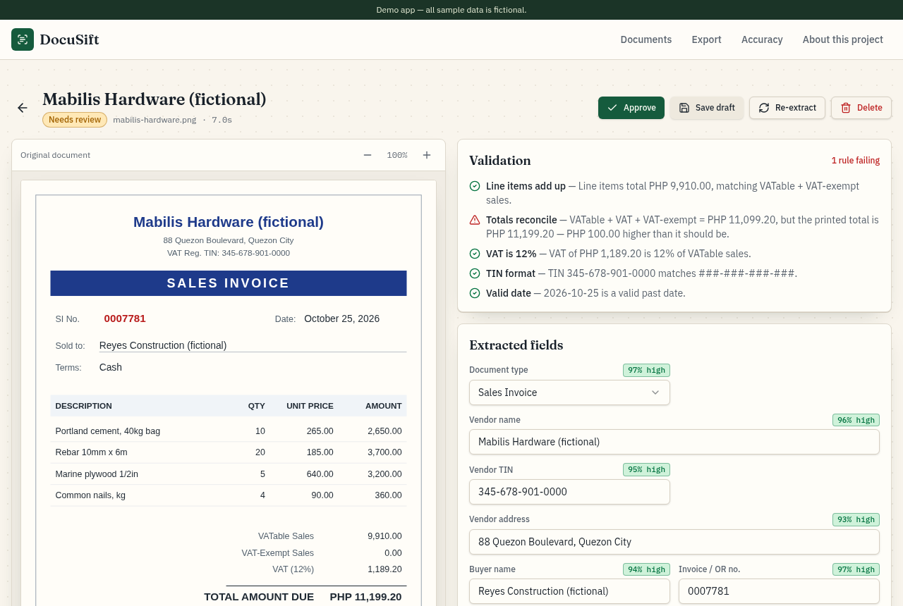
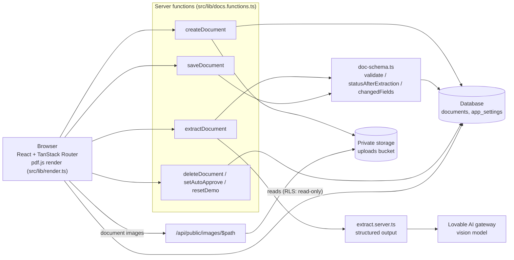
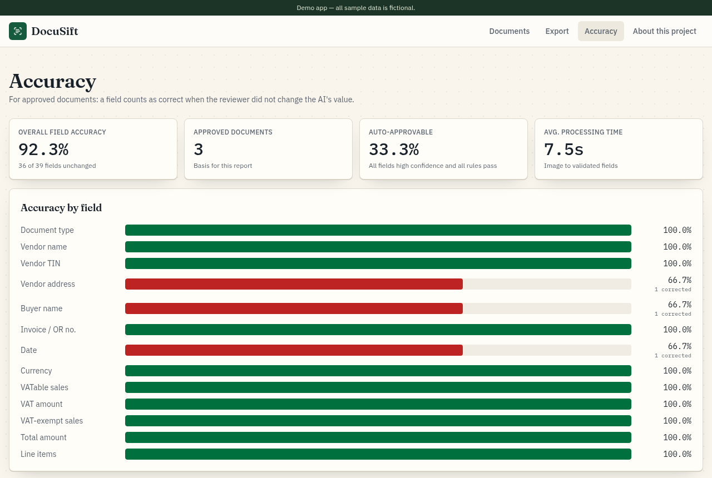

# DocuSift

Turns Philippine invoices and official receipts into validated, structured data, with a human review step for anything uncertain.

**Live demo:** https://docusift-uriel.lovable.app

Demo app. All sample data is fictional.



## The problem

Bookkeepers, accounting staff and small finance teams in the Philippines still key invoices and official receipts into spreadsheets by hand. It is slow, and typing errors in TINs, VAT amounts or totals surface later as mismatches during reconciliation or tax filing. Fully automatic extraction is not enough either, because nobody can trust a number without knowing how sure the system was and whether the math adds up.

## What it does

- **Documents** (home): upload a PNG, JPG or PDF (up to 10 MB) by drag and drop, or click "Try a sample document" to run one of three bundled fictional invoices. A table lists every document with its vendor, total, date and status (Processing, Needs review, Approved, Failed), with filters.
- **Extraction**: a vision model reads a fixed schema (document type, vendor, TIN, address, buyer, invoice number, date, currency, VATable / VAT / VAT-exempt amounts, total, line items). Every field comes back with a confidence score.
- **Validation in code**: five rules check the arithmetic, VAT rate, TIN format and date. The model never decides pass or fail.
- **Review** (`/documents/:id`): zoomable document image beside editable fields with green / amber / red confidence badges, an editable line-item table and a Validation panel. Buttons: Approve, Save draft, Re-extract, Delete. Approving records which fields the reviewer changed.
- **Export**: filter approved documents by date, preview rows, and download a per-document CSV or a per-line-item CSV.
- **Accuracy**: field-level accuracy (fields not changed by the reviewer ÷ total fields), per field and overall, plus the share of documents that were auto-approvable and the average processing time.
- **Reset demo data** restores the four seed documents. An "Auto-approve clean documents" setting is off by default.



## How it works

The pattern is **extract, then verify in code, then route to a human**. The model only reads the document. Deterministic rules check what it read. Anything the rules reject, or the model was unsure about, waits for a person.

1. The browser turns the file into an image. PDFs are rendered to an image (first page) with pdf.js in `src/lib/render.ts`. Bundled samples are SVGs rendered to PNG.
2. `createDocument` stores the image in a private storage bucket and inserts a `documents` row with status `processing`.
3. `extractDocument` calls a vision model through the Lovable AI gateway (`src/lib/extract.server.ts`) using structured output against a Zod schema. The call aborts after 90 seconds.
4. `validate()` and `statusAfterExtraction()` in `src/lib/doc-schema.ts` run the rules and set the status. Any field below 0.75 confidence or any failed rule means Needs review. Otherwise the document is approved only if auto-approve is on.
5. On the Review screen, `saveDocument` stores the final values and uses `changedFields()` to record what the reviewer edited. The Accuracy page computes its numbers from those records.

Validation rules (tolerance ±1.00):

- Line item amounts sum to VATable + VAT-exempt sales.
- VATable + VAT + VAT-exempt equals the total.
- VAT is 12% of VATable sales.
- TIN matches `###-###-###-###` (last group 3 to 5 digits).
- Invoice date is valid and not in the future.

Confidence badges: green at 0.9 and above, amber from 0.75 to below 0.9, red below 0.75.



All writes go through server functions. The browser reads tables directly, and Row Level Security allows reads only. Images live in a private bucket and are served through the `/api/public/images/$path` route.

## Data model

| Table | What it holds |
| --- | --- |
| `documents` | One row per uploaded document: file name, image URL, status, the raw model output (`extracted`), the current reviewed values (`data`), per-field `confidence`, `changed_fields` from review, `processing_ms`, `error` message, `is_seed` flag, and created / updated / approved timestamps. |
| `app_settings` | A single row with the `auto_approve` setting. |

A `reset_demo()` SQL function restores the four fictional seed documents. Images are stored in the private `uploads` storage bucket.

## Quality and testing

Browser QA of the published app:

- All three fictional sample invoices were run through the real model. Every extracted field matched the images.
- Sample 3 (Mabilis Hardware) has a deliberate PHP 100.00 total error. The totals rule caught it ("PHP 100.00 higher than it should be") and the document went to Needs review.
- Editing one vendor name on Review and approving dropped "Vendor name" accuracy on the Accuracy page from 100% to 75%.
- Export produced both the per-document and the per-line-item CSV.
- An unreadable image ends as Failed with a clear message and a Retry button, with no endless spinner.
- Found in QA and fixed: uploads could stall in a background browser tab. Image loading now has a 20-second timeout.

Automated tests (Vitest, `npm test`):

- `src/test/doc-rules.test.ts`: validation rules (samples 1 and 2 pass every rule, sample 3 fails only the totals rule, ±1.00 tolerance, 3 to 5 digit TIN last group, future dates rejected), status routing (low confidence, failed rule, auto-approve off and on), and accuracy (an edited field drops below 100%).
- `src/test/app-routing.test.tsx`: the home route `/` resolves to a page instead of "not found".



## Tech stack

- **Frontend:** React 19, TanStack Router, TanStack Query, Tailwind CSS v4, Radix UI primitives, Recharts, pdfjs-dist.
- **Server:** TanStack Start server functions (`createServerFn`) and one server route, running on an edge (Cloudflare Workers) runtime. Zod for input validation.
- **Database and storage:** Lovable Cloud (Postgres with Row Level Security, private file storage) via `@supabase/supabase-js`.
- **AI:** Vercel AI SDK (`ai`, `@ai-sdk/openai`) calling a vision model through the Lovable AI gateway, with structured output.
- **Build and tests:** Vite 7, Vitest.
- **Hosting:** Lovable.

## Run locally

Prerequisites: Node 22.

```sh
npm i
npm run dev
```

Environment variables (names only):

- `SUPABASE_URL`, `SUPABASE_PUBLISHABLE_KEY`, `SUPABASE_PROJECT_ID`
- `VITE_SUPABASE_URL`, `VITE_SUPABASE_PUBLISHABLE_KEY`, `VITE_SUPABASE_PROJECT_ID`
- Server-side: `SUPABASE_SERVICE_ROLE_KEY` (used by server functions for writes) and `LOVABLE_API_KEY` (used for AI calls)

Note: AI calls use the Lovable AI gateway, which only works with Lovable Cloud. To run elsewhere, replace the calls in `src/lib/extract.server.ts` with your own model provider key.

## Limitations and next steps

- Public demo with no login. Anyone can upload, edit, approve or reset data. A real deployment needs authentication, per-organization data, roles (preparer vs. approver) and an audit log.
- Only the first page of a PDF is extracted. Multi-page invoices would need page-by-page extraction and merging of line items.
- Accuracy is measured from reviewer edits, which assumes reviewers catch every error. A real deployment would add a labeled test set and track accuracy over time and per model version.
- Validation covers arithmetic and format only. Next steps: check TINs and vendors against a master list, detect duplicate invoice numbers, and push approved data to an accounting system instead of CSV.
- No background queue. Extraction runs inside a single request, so large batches would need a job queue with retries.

## Author

Uriel Papa. [GitHub](https://github.com/Edamuza) · [LinkedIn](https://www.linkedin.com/in/uriel-papa-vitese01/)

Built with Lovable (AI app builder) from a written spec, then tested against acceptance checks and fixed.
